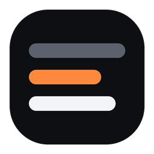
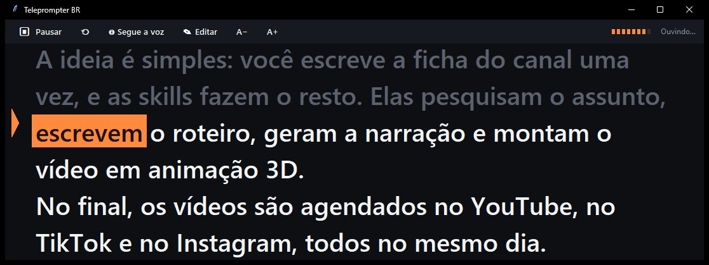
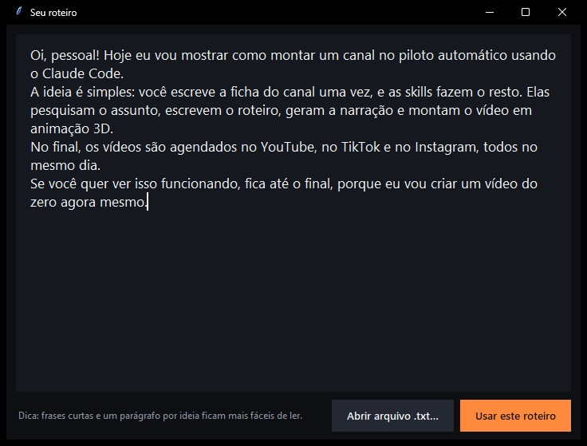

<div align="center">




**Um teleprompter para Windows que segue a sua voz em português, palavra por palavra.**

<p>
  
  
  
  
</p>

<p>
  <a href="#instalacao"></a>
  <a href="https://sparks-gamesstudio.github.io/fabrica-de-canais/github.html"></a>
  
</p>



</div>

## 👋 O Rebite explica


> Gravar vídeo lendo roteiro é um sufoco: ou você decora, ou fica rolando o texto com o mouse e o olho foge da câmera. Aqui o texto anda sozinho no ritmo da sua fala. Se você parar para respirar, ele espera; se errar uma palavra, ele se encontra de novo.

<br clear="right" />

## 🎙️ Como funciona

Cole o seu roteiro, aperte **espaço** e comece a ler em voz alta.

- A **palavra em laranja** é a próxima que você vai dizer.
- O que você já leu fica apagado, e a linha atual fica sempre no alto da janela, perto da câmera.
- O reconhecimento de voz roda **no seu PC**, sem internet e sem mandar o seu áudio para ninguém.
- Ele tolera erro: o reconhecedor às vezes ouve "claudio coutinho" quando você diz "Claude Code", e mesmo assim o texto segue no lugar certo.

Testado com uma narração de 34 segundos: acompanhou as 89 palavras do roteiro até o fim, com menos de 1 segundo de atraso.

## 🎛️ Três modos

| Modo | Para quê |
|---|---|
| **Segue a voz** | o texto acompanha cada palavra que você diz (o padrão) |
| **Rola enquanto fala** | rola numa velocidade fixa, mas só quando você está falando |
| **Rolagem fixa** | rolagem clássica de teleprompter, sem microfone |



## ⌨️ Atalhos

| Tecla | O que faz |
|---|---|
| `Espaço` | começa e pausa |
| `Home` | volta ao começo |
| `E` | abre o editor de roteiro (cole o texto ou abra um `.txt`) |
| `M` | troca o modo |
| `↑` `↓` | velocidade nos modos de rolagem |
| `Ctrl +` `Ctrl −` | tamanho da letra |
| clique numa palavra | pula para ela, se você se perder |
| `Esc` | fecha |

A janela fica sempre por cima das outras. Arraste para perto da câmera e ajuste o tamanho: ela lembra onde estava.

<a id="instalacao"></a>
## ⬇️ Instalação

1. Instale o [Python 3.10 ou mais novo](https://www.python.org/downloads/) marcando **"Add python.exe to PATH"**.
2. [Baixe este repositório](https://github.com/sparks-gamesstudio/teleprompter-br/archive/refs/heads/main.zip) e descompacte.
3. Dê dois cliques em **`instalar.bat`**.

O instalador cria um ambiente isolado, instala o que precisa e cria atalhos no Menu Iniciar e na Área de Trabalho. Na primeira vez, o Teleprompter baixa o modelo de voz em português (50 MB).

<table>
<tr>
<td width="100"></td>
<td>É só isso. Abriu, colou o roteiro, apertou espaço e pode gravar.</td>
</tr>
</table>

### Para quem gosta de código

```bash
git clone https://github.com/sparks-gamesstudio/teleprompter-br.git
cd teleprompter-br
python -m venv .venv && .venv\Scripts\activate
pip install -r requirements.txt
python -m teleprompter
```

| Arquivo | O que faz |
|---|---|
| `teleprompter/acompanhar.py` | encontra onde você está no roteiro, tolerando erros do reconhecimento |
| `teleprompter/voz.py` | microfone e reconhecimento offline com [Vosk](https://alphacephei.com/vosk/) |
| `teleprompter/app.py` | a janela, a rolagem suave, os modos e o editor |

## 💭 Limites honestos

<table>
<tr>
<td width="100"></td>
<td>O modelo de voz é pequeno, para rodar em qualquer PC: nomes estrangeiros e números escritos com algarismos ("2026") são os pontos mais frágeis. Prefira escrever os números por extenso no roteiro. Ainda não há modo espelhado para vidro de teleprompter.</td>
</tr>
</table>

## 🙌 Créditos

Inspirado no [Textream](https://github.com/f/textream) (MIT), que existe só para Mac, iPhone e iPad. Esta versão foi escrita do zero para Windows e para o português do Brasil. Reconhecimento de voz com [Vosk](https://github.com/alphacep/vosk-api) (Apache-2.0).

---

<div align="center">

<a href="https://sparks-gamesstudio.github.io/fabrica-de-canais/"></a>

Feito pela **[Fábrica de Canais](https://sparks-gamesstudio.github.io/fabrica-de-canais/)**, skills de Claude Code para canais de vídeo no piloto automático.

<a href="https://instagram.com/afabricadecanais"></a>
<a href="https://github.com/sparks-gamesstudio"></a>

<sub>Licença MIT · use, modifique e compartilhe. Se ajudou, deixa uma ⭐</sub>


</div>
